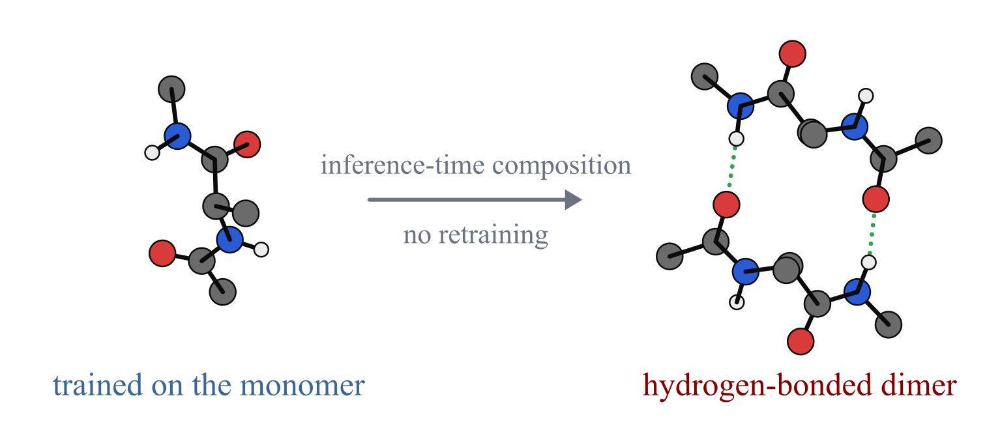
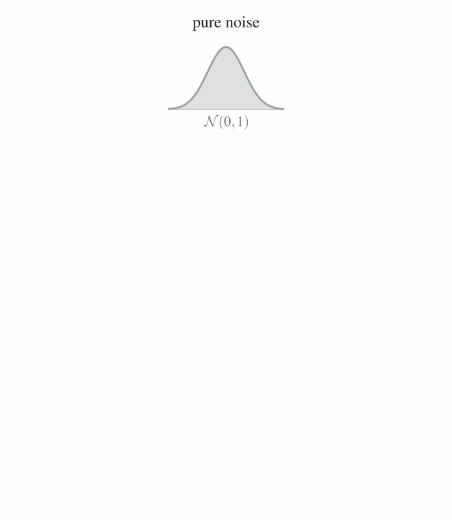
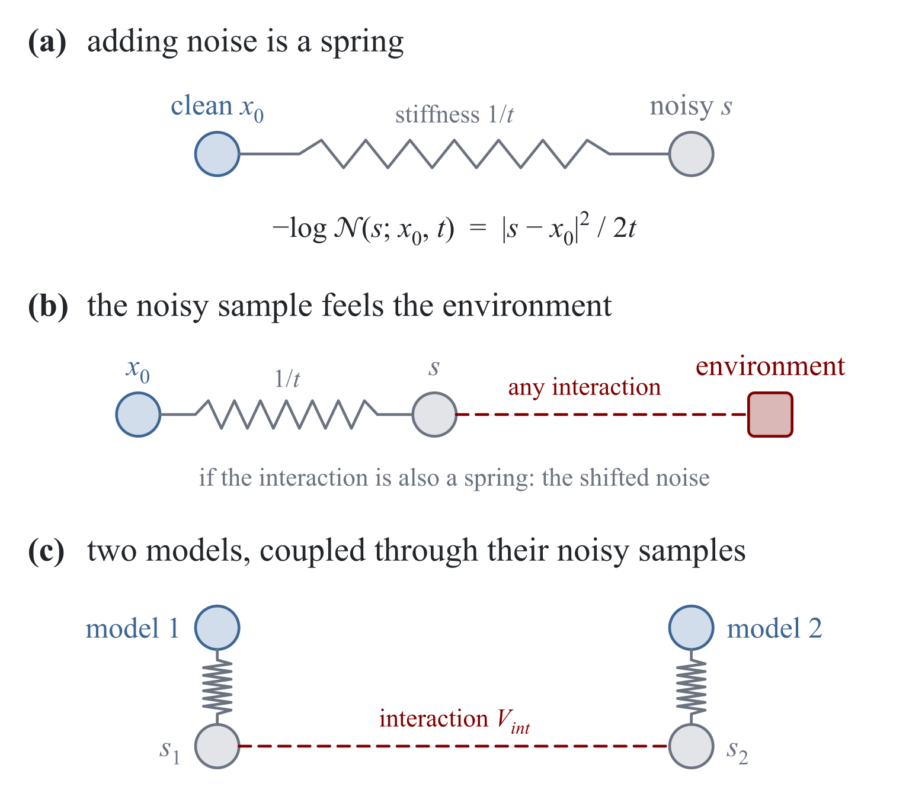
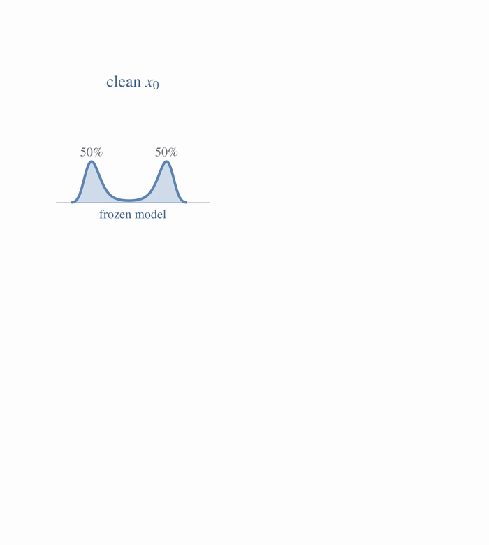
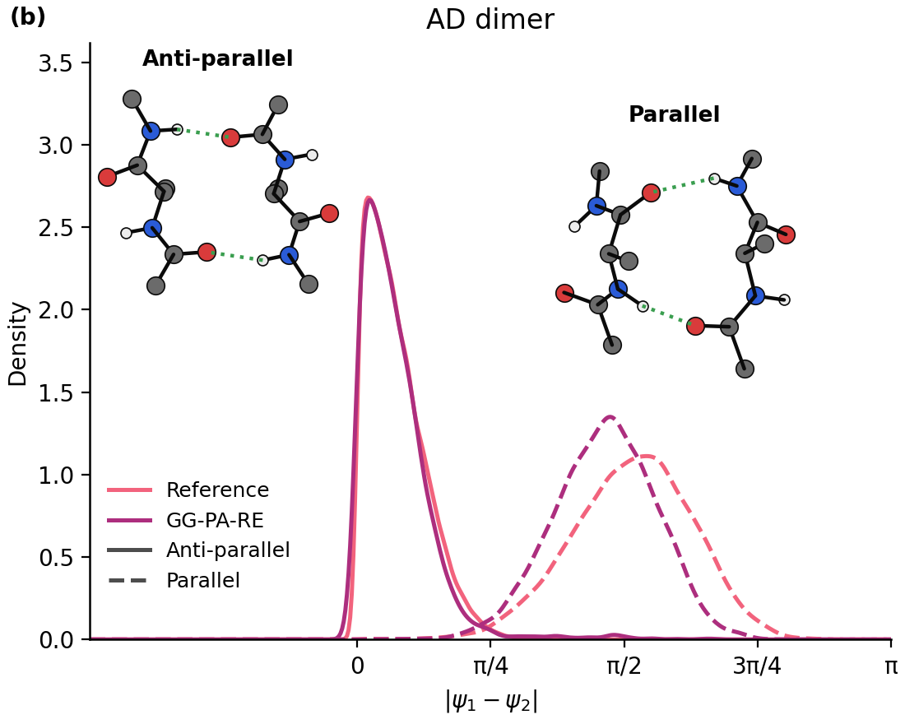
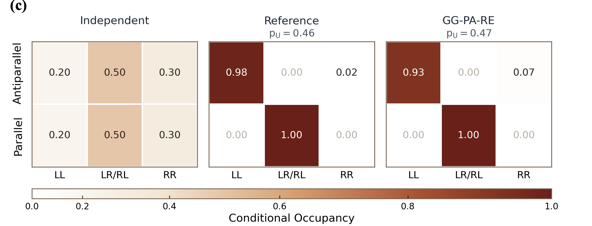
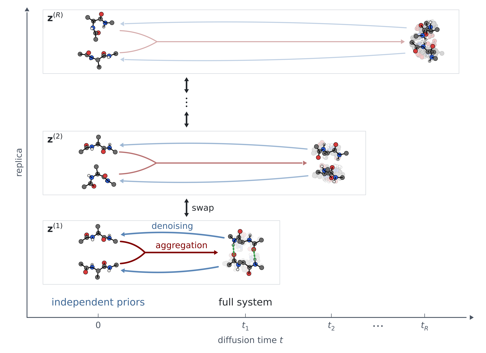
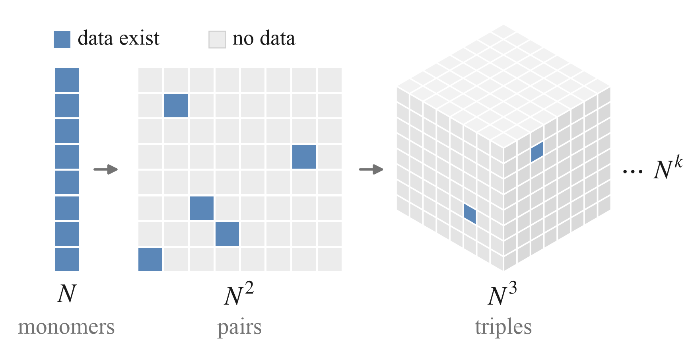

> NeurIPS 2026 · [Paper](https://arxiv.org/abs/2605.10642) · [Code](https://github.com/weizhouwangw/GG-PA) · [Colab](https://colab.research.google.com/github/weizhouwangw/GG-PA/blob/main/quickstart/colab.ipynb) · [Talk at MSR New England](https://www.microsoft.com/en-us/research/video/generative-gibbs-sampling-composing-generative-models-with-explicit-physical-context/) · [中文版](https://zhuanlan.zhihu.com/p/2103709265726855003)

Generative models for molecules have become good at single objects such as a protein, an RNA strand or a small molecule. The questions that scientists care about are usually about objects together, such as a protein bound to RNA, a peptide next to an ion, or two molecules forming a dimer. That is where the data runs out (see [Q1](#q1)). There are far more combinations than anyone can simulate or measure, so there is rarely enough data to train a model on the combination itself.

This leaves a gap between what we can train and what we want to sample. This post is about one way to address it. We keep the models we already have, each trained on one part, and compose them at inference time through the physics of how the parts interact. Nothing is retrained or fine-tuned. The method is GG-PA (Generative Gibbs for Physics-Aware Sampling), from our [NeurIPS 2026 paper](https://arxiv.org/abs/2605.10642).

<figure class="post-figure">

<figcaption><strong>Figure 1.</strong> A model trained on a single molecule (left) is composed at inference time with a second copy of itself and the interaction between the two molecules. Together they sample the hydrogen-bonded dimer (right), which neither copy was trained on.</figcaption>
</figure>

To make the question concrete, say you have two diffusion models, one trained on molecule 1 alone and the other on molecule 2 alone. Neither model has ever seen the complex. What can we do with these two monomer models as they are, together with the physics of how the two molecules interact?

## The setup

Physics tells us what the target looks like. The energy of the complex is the energy of each part plus an **interaction term**,

$$
V(x_1,x_2) = V_1(x_1) + V_2(x_2) + V_{\mathrm{int}}(x_1,x_2)
$$

so the Boltzmann distribution of the complex factorizes as

$$
p(x_1,x_2) \propto p_1(x_1) \cdot p_2(x_2) \cdot \exp\left(-\beta V_{\mathrm{int}}(x_1,x_2)\right)
$$

The first two factors are what the two models already know. The third is physics that we can write down and evaluate, such as Coulomb and Lennard-Jones interactions. We will call it the **physical context**. The job is to make the two models cooperate under a known interaction.

The trouble is that $$V_{\mathrm{int}}$$ couples variables that no single model has seen together. Model 1 knows about $$x_1$$ only. Guiding it in the usual way would require the effect of $$x_2$$ on $$x_1$$ with $$x_2$$ integrated out, which is a free energy that we generally cannot compute in high dimensions. Even with that free energy in hand, we would get samples of $$x_1$$ alone and not of the complex.

GG-PA takes a different route. It starts from a simple observation. The noise that a pretrained model adds can be regarded as a harmonic spring that connects the noisy sample to the clean sample. By adding an extra interaction on the noisy sample, we control what the model produces, and this change to the added noise is what eventually makes two models aware of each other. In this way we change the outcome of a pretrained model without changing its parameters, purely through computation at inference time. In the paper we treat $$K$$ models, $$p_1,\dots,p_K$$, and show that the sampler is exact when the interaction is quadratic, $$V_{\mathrm{int}}=\tfrac{1}{2}x^\top A x$$ with $$x=(x_1,\dots,x_K)$$ ([Q2](#q2)).


In this post we first show how to steer a pretrained model by changing the noise added at inference time, which leads to a completely different output distribution. We then show an example, the assembly of an alanine dipeptide dimer. At the end, [Q1](#q1) explains why data on complexes is scarce, [Q2](#q2) discusses when the framework is exact, and [Q3](#q3) compares GG-PA with guidance and other methods.


## Steering a frozen model with noise

For simplicity, take one model first. Let $$x_0$$ be a clean sample, with 0 for no noise, and $$s$$ a noisy one. In this setting, the forward process adds Gaussian noise of variance $$t$$, so that

$$
q(s|x_0) = \mathcal{N}(s;\, x_0,\, tI)
$$

Training teaches the model, through its score network, to reverse this. Given a noisy $$s$$, running the reverse process from noise level $$t$$ down to zero returns a clean sample, and the samples it returns follow the posterior

$$
p(x_0|s) = \frac{p(x_0)\, q(s|x_0)}{p_t(s)}, \qquad p_t(s) = \int p(x_0)\, q(s|x_0)\, dx_0
$$

At the maximum noise level, $$t=T$$, the noisy distribution $$p_T$$ is close to a Gaussian, so we can draw $$s$$ from this Gaussian and denoise it, which amounts to

$$
p(x_0) = \int p_{T}(s)\, p(x_0|s)\, ds
$$

This is the standard way to generate samples. There is another way. We can start from samples of any distribution, add noise to get $$s$$, and then denoise to get $$x_0'$$. One round of this is

$$
s = x_0 + \sqrt{t}\,\eta,\quad \eta \sim \mathcal{N}(0, I); \qquad x_0' \sim p(x_0|s)
$$

Repeating this round builds a Markov chain whose stationary distribution is again $$p(x_0)$$, and the chain converges to it from any starting distribution. The two moves are the two conditionals of the joint distribution $$p(x_0)\,q(s\vert x_0)$$, which is why this procedure is called Gibbs sampling.

Gibbs sampling gives us a knob for controlling what a model generates without changing any of its parameters. We only change the noise we add, from the training noise to a completely different one. In the double-well example below, adding the training noise simply gives back the training distribution, with half of the samples in each well. In contrast, if we add Gaussian noise that is shifted to the right, most of the samples move to the right well. In both cases the denoising model is the same (the same network, sampled in the same way), yet Gibbs sampling gives a completely different distribution.


<figure class="post-figure">

<figcaption><strong>Figure 2.</strong> One frozen model with two kinds of noise. With the training noise (top row) the chain stays at 50/50. With a shifted noise (bottom row) it settles with 91% of the samples in the right well.</figcaption>
</figure>

What remains is to decide which noise to add.


## Noise as a spring

We can write the noising step as an energy. The negative log of the Gaussian is

$$
-\log q(s|x_0) = \frac{|s - x_0|^2}{2t} + \text{const}
$$

This is the energy of a spring of stiffness $$1/t$$ that ties $$s$$ to $$x_0$$. The less noise we add, the stiffer the spring. Adding noise amounts to putting a particle, the noisy sample, on a spring anchored at the clean sample and letting it fluctuate.

A particle on a spring can be pushed by other forces too, and this is how the physics comes in. We let the noisy sample interact with an environment, or with the noisy sample of another model.

<figure class="post-figure">

<figcaption><strong>Figure 3.</strong> (a) Adding noise is a spring of stiffness \(1/t\). (b) The noisy sample is coupled to an environment through any known interaction. (c) Two models interact through their noisy samples.</figcaption>
</figure>

Consider one model in an environment whose degrees of freedom are $$s_{\mathrm{env}}$$, and let the noisy sample interact with it through a known energy $$U(s, s_{\mathrm{env}})$$. In the noising step we now hold $$x_0$$ fixed and sample the noisy sample and the environment together from

$$
\pi_t(s,\, s_{\mathrm{env}} \mid x_0) \;\propto\; q(s|x_0)\cdot \exp\left(-\beta U(s, s_{\mathrm{env}})\right)
$$

The first factor is the spring from the training noise and the second is the physics. We call this step **aggregation**. Unless everything is Gaussian it has no closed form, so we run MCMC or molecular dynamics (MD) on $$s$$ and $$s_{\mathrm{env}}$$.

Through this step the noisy sample interacts with the environment and vice versa. In the example below, both the noisy sample and the environment move according to the interaction we impose.

The denoising step stays as it was, and it brings this information into the clean sample $$x_0$$. Alternating the two steps again gives a Gibbs sampler, now for the joint distribution

$$
\pi_t(x_0, s, s_{\mathrm{env}}) \;\propto\; p(x_0)\cdot q(s|x_0)\cdot \exp\left(-\beta U(s, s_{\mathrm{env}})\right)
$$

whose two conditionals are the aggregation step above and

$$
\pi_t(x_0 \mid s,\, s_{\mathrm{env}}) \;\propto\; p(x_0)\, q(s|x_0) \;\propto\; p(x_0|s)
$$

The environment has dropped out of the second conditional. This is why the model never has to be modified.

<figure class="post-figure">

<figcaption><strong>Figure 4.</strong> Aggregation and denoising alternate, and the clean samples end on the exact marginal (dashed). The numbers are those of Figure 2. Integrating this environment out gives exactly the shifted noise used there.</figcaption>
</figure>

You can run a version of this example yourself, either with the double-well quickstart in the [code repository](https://github.com/weizhouwangw/GG-PA/tree/main/quickstart) or in the browser as a [Colab notebook](https://colab.research.google.com/github/weizhouwangw/GG-PA/blob/main/quickstart/colab.ipynb).

With several models, nothing changes (Figure 3c). Model $$i$$ has a clean sample $$x_i$$ and a noisy sample $$s_i$$, and the interaction acts between the noisy samples. Each model sees the others as its environment, and the denoising steps run in parallel.


## A dimer from a monomer model

Here we use the framework to sample the dimer of alanine dipeptide (AD) without any dimer data. We train a diffusion model on a single AD in vacuum, where it learns the physics of the monomer, and then use two copies of it, with the interaction supplied by a force field (Figure 1).

A single AD sits mostly in two conformations, which we call L and R. Two AD molecules can hydrogen-bond to each other in an anti-parallel or a parallel arrangement, and the two arrangements show up at different values of $$\vert \psi_1-\psi_2\vert $$, the difference between the backbone dihedral angles $$\psi$$ of the two molecules.

<figure class="post-figure">

<figcaption><strong>Figure 5.</strong> The two hydrogen-bonded arrangements of the dimer and the distribution of \(|\psi_1-\psi_2|\) in each, with solid lines for anti-parallel and dashed lines for parallel.</figcaption>
</figure>

The composed sampler finds both arrangements, and in each of them the distribution of $$\vert \psi_1-\psi_2\vert $$ is close to that of reference MD on the full dimer. These results use GG-PA-RE, a replica-exchange variant described below.

A sharper test is which conformations the two molecules adopt inside each arrangement. Independent molecules would give LL, LR/RL and RR with probabilities 0.20, 0.50 and 0.30, the products of the monomer probabilities, and these would be the same in both arrangements.

<figure class="post-figure">

<figcaption><strong>Figure 6.</strong> Probabilities of the conformation pairs within each arrangement, for two independent monomers (left), reference MD (middle) and GG-PA-RE (right). \(p_U\) is the fraction of configurations that belong to neither arrangement.</figcaption>
</figure>

The dimer does something else. The anti-parallel arrangement is almost entirely LL (0.98 in the reference, 0.93 with GG-PA-RE), and the parallel arrangement is entirely LR/RL (1.00 in both). The monomer model was never shown a dimer, so this correlation between the two molecules is produced entirely by the composition.

Now for replica exchange (RE). Small noise makes the sampler accurate, but the spring becomes stiff and the chain mixes slowly. GG-PA-RE runs several chains at different noise levels $$t$$ and lets neighboring chains swap their configurations. This is the idea of parallel tempering, with the noise level in the role of temperature. In our tests it mixes faster than a single chain and keeps the accuracy of the lowest noise level.

<figure class="post-figure">

<figcaption><strong>Figure 7.</strong> Each row is a replica, and the noise level \(t\) grows from bottom to top. Within a replica, aggregation and denoising alternate, and neighboring replicas swap. The clean samples of the two models are on the left and the noisy dimer is on the right. At low noise (bottom) the structure is sharp. At high noise (top) the chain moves between arrangements more easily.</figcaption>
</figure>


## Summary

GG-PA composes pretrained diffusion models with explicit physics at inference time. The noise is treated as a spring, the noisy samples carry the interactions, and denoising hands the result back to each model. The models serve as black-box denoisers and are never retrained or fine-tuned.

We think of this as a modular way to build samplers. We train reusable models for the parts and then assemble them with whatever physics the system calls for, without training a new model each time the system or its environment changes.

A few things from the paper did not fit here. For quadratic interactions the sampler is exact, through a Gaussian deconvolution that is sketched in [Q2](#q2), and the $$\phi^4$$ lattice model in the paper is an example. With a linear-Gaussian likelihood, the same correction removes the bias of plug-and-play Gibbs samplers for linear inverse problems and gives an unbiased sampler built on a pretrained diffusion model. There is also a route from here to imaginary-time path integrals in which the sampling temperature becomes transferable (the $$\phi^4$$ model is already a 2D example).

The [paper](https://arxiv.org/abs/2605.10642) has the proofs, the $$\phi^4$$ lattice model and an example with an ion as the environment. The [code](https://github.com/weizhouwangw/GG-PA) is on GitHub, with a quickstart that also runs in the browser on [Colab](https://colab.research.google.com/github/weizhouwangw/GG-PA/blob/main/quickstart/colab.ipynb), and there is a [recorded talk](https://www.microsoft.com/en-us/research/video/generative-gibbs-sampling-composing-generative-models-with-explicit-physical-context/) from MSR New England. Questions are welcome, and my contact details are on the [home page](/).


## Questions

### Q1: Why not train one model on the complex? {#q1}

Mostly because the data is not there. $$N$$ kinds of components can form on the order of $$N^2$$ dimers and $$N^3$$ trimers, so the number of possible complexes outruns any dataset. Data on individual components is often plentiful, while data on their combinations is nearly absent.

<figure class="post-figure">

<figcaption><strong>Figure 8.</strong> The components have data. Most of their combinations do not.</figcaption>
</figure>

There is a second reason. Most models describe only some of the degrees of freedom, such as a protein backbone or a molecular fragment, and whatever environment was present in the training data is built in implicitly. When the environment changes, the model no longer applies, so a model trained for one specific system transfers poorly to another.

### Q2: When is the sampler exact? {#q2}

The target is

$$
p(x_1,x_2) \propto p_1(x_1)\, p_2(x_2)\, \exp\left(-\beta V_{\mathrm{int}}(x_1,x_2)\right)
$$

and the joint distribution that the sampler defines is

$$
\pi_t(x_1,s_1,x_2,s_2) \propto p_1(x_1)\, p_2(x_2)\, q(s_1|x_1)\, q(s_2|x_2)\, \exp\left(-\beta U(s_1,s_2)\right)
$$

where $$U$$ is an interaction between the noisy samples that we are free to choose. The clean samples have the right marginal if integrating out the noisy samples gives back $$V_{\mathrm{int}}$$, that is, if

$$
\int ds_1\, ds_2\; q(s_1|x_1)\, q(s_2|x_2)\, \exp\left(-\beta U(s_1,s_2)\right) \;\propto\; \exp\left(-\beta V_{\mathrm{int}}(x_1,x_2)\right)
$$

So $$U$$ has to be $$V_{\mathrm{int}}$$ with the noise deconvolved out of it.

For Gaussian noise, $$q(s_i\vert x_i)=\mathcal{N}(s_i;\, x_i,\, tI)$$, and a quadratic interaction, $$\exp\left(-\beta V_{\mathrm{int}}(x)\right) \propto \mathcal{N}(x;\, \mu,\, \Sigma)$$ with $$x=(x_1,x_2)$$, the deconvolution can be done by hand and gives

$$
\exp\left(-\beta U(s)\right) \;\propto\; \mathcal{N}(s;\, \mu,\, \Sigma - tI), \qquad s=(s_1,s_2)
$$

The interaction between the noisy samples is the original one with the noise variance $$t$$ subtracted from its covariance. This requires $$\Sigma - tI$$ to be positive semidefinite, which caps the noise level at some $$t_{\max}$$.

For a general $$V_{\mathrm{int}}$$ there is no closed form. The simplest choice is $$U=V_{\mathrm{int}}$$, and it leaves an error that shrinks as the noise goes to zero. Small noise mixes slowly, however, and that trade-off is the reason for replica exchange.

### Q3: How does this relate to guidance, score composition and plug-and-play? {#q3}

The product of factors in "The setup" is a product of experts in the sense of Hinton (2002). That is the target. The methods below, like GG-PA, are ways of sampling such a target with pretrained diffusion models, and they differ in what they can couple and in whether they are exact at a finite noise level.

**Guidance and posterior sampling.** Classifier guidance (Dhariwal and Nichol 2021), classifier-free guidance (Ho and Salimans 2022) and diffusion posterior sampling (Chung et al. 2023) steer one model with a likelihood or an energy on that model's own variables. Anything outside those variables has to be integrated out first, and at noise level $$t$$ that integral is a free energy we cannot compute. GG-PA keeps the outside variables explicit, so there is nothing to integrate out.

**Score composition** (Liu et al. 2022, Du et al. 2023) combines several models that live on the same variable by adding their scores. The product of noised distributions is not the noised product, so adding scores is inexact at every finite noise level, and Du et al. add MCMC steps to correct it. In GG-PA the models can describe different parts of the system, and what joins them is an energy we evaluate, not another learned model.

**Split Gibbs and plug-and-play samplers** (Vono et al. 2019, Coeurdoux et al. 2024) are the closest relatives. They also alternate a denoising step with a likelihood step through an auxiliary noisy copy, and with one model and a linear-Gaussian likelihood GG-PA reduces to split Gibbs. Standard split Gibbs is biased at any finite noise level, because the auxiliary copy inflates the covariance of the likelihood. The deconvolution of [Q2](#q2) removes that bias. Beyond this special case, GG-PA treats the noisy variables as the physical state of the whole system, which is what lets it handle several partial models and an explicit environment.

The related-work section of the [paper](https://arxiv.org/abs/2605.10642) has the full list of references.


## Citation

If you use this work, please cite the paper.

```bibtex
@inproceedings{wang2026ggpa,
  title = {Composing Diffusion Priors with Explicit Physical Context via Generative Gibbs Sampling},
  author = {Wang, Weizhou and Weare, Jonathan and Dinner, Aaron R.},
  booktitle = {Advances in Neural Information Processing Systems},
  year = {2026},
  eprint = {2605.10642},
  archivePrefix = {arXiv}
}
```

<style>
@media (min-width: 925px) {
  #main > article.page { float: none; width: auto; max-width: 780px; margin-left: auto; margin-right: auto; padding-left: 0; padding-right: 0; }
}
.page__content figure.post-figure { display: block; margin: 1.8em 0; }
.page__content figure.post-figure img { display: block; width: auto; max-width: 100%; max-height: 640px; margin: 0 auto 0.7em; border-radius: 4px; }
.page__content figure.post-figure figcaption { font-family: inherit; font-size: 0.85em; line-height: 1.5; font-style: normal; opacity: 0.8; }
.page__content mjx-container[display="true"] { max-width: 100%; overflow-x: auto; overflow-y: hidden; padding: 2px 0; }
.page__content h2, .page__content h3 { scroll-margin-top: 4.5em; }
.page__footer { position: static; }
body { margin-bottom: 0; }
</style>
